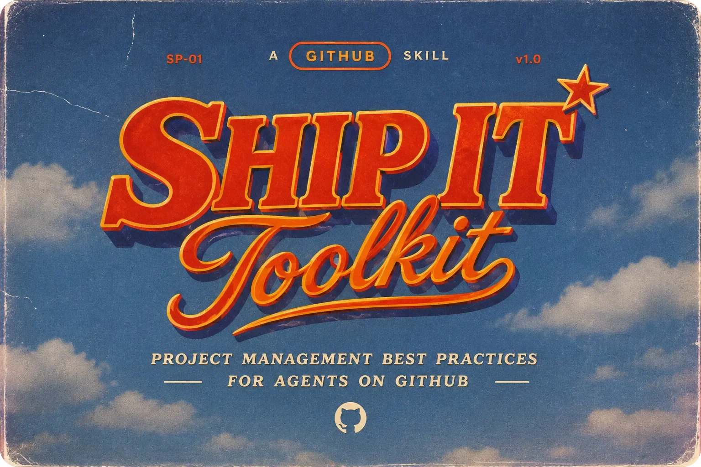

<p align="center">
  
</p>

<h1 align="center">Ship It Toolkit</h1>

<p align="center"><strong>From idea to release, one issue at a time.</strong></p>

<p align="center">
  <a href="https://github.com/MartinMrnn/ship-it-toolkit/releases"></a>
  <a href="LICENSE"></a>
  <a href="https://docs.claude.com/en/docs/claude-code/skills"></a>
  <a href="https://docs.github.com/en/issues/planning-and-tracking-with-projects"></a>
  <a href="https://github.com/MartinMrnn/ship-it-toolkit/stargazers"></a>
</p>

<p align="center">
  <a href="#install-once-per-machine">Install</a> ·
  <a href="#the-flow">The flow</a> ·
  <a href="#day-to-day">Day to day</a> ·
  <a href="#license">License</a>
</p>

---

A small, no-nonsense project workflow for solo developers (or pairs) who build with [Claude Code](https://docs.claude.com/en/docs/claude-code). It runs on what GitHub already gives you — Issues, Projects, Milestones and their built-in automations — plus one Claude Code skill, `github-flow`, that does the paperwork.

- **Issues** are your backlog.
- **One milestone = one version** (`vX.Y.Z`, the same name as the tag).
- **One branch and one PR per issue.**
- **No GitHub Actions, no tokens** to keep the board up to date: GitHub moves the cards itself.

## The flow

| Phase | Status on the board | Who |
|---|---|---|
| Idea | `Backlog` | you (web, mobile) or `capture`; the issue joins the board on its own |
| Planning | `Ready` + milestone | **you** |
| Spec | `Spec` | `start #N` (brainstorming, local spec) |
| Development | `Dev` | `start #N`, once the plan is approved |
| Tests and review | `Review` | `ship` opens the PR; GitHub moves the issue |
| Merge | `Done` | **you**; GitHub closes the issue |
| Release | published release | `release vX.Y.Z` |

You keep the decisions (what, when, which version, merge). The agent does the rest, and ends every command with a **Manual steps** block that lists what is left for you — or "None."

## What's inside

```
skills/github-flow/
├── SKILL.md                     the five commands: setup, capture, start, ship, release
├── set-field.sh                 sets Status or Priority on an issue, by name
└── templates/                   copied into each repository by setup
    ├── ISSUE_TEMPLATE/          "Idea" and "Bug" issue forms
    └── pull_request_template.md Closes #, Decisions, Tests
```

## Requirements

- [GitHub CLI](https://cli.github.com) (`gh`) and `jq`.
- [Claude Code](https://docs.claude.com/en/docs/claude-code).
- Recommended: the [superpowers](https://github.com/obra/superpowers) plugin, which `start` uses for brainstorming, planning and test-driven development. Without it, `start` still works with a short spec written with you.

## Install (once per machine)

1. Sign in to GitHub with access to Projects:
   ```bash
   gh auth login --scopes project
   ```
   Already signed in? Add the scope:
   ```bash
   gh auth refresh -s project
   ```
2. Install the skill:
   ```bash
   git clone https://github.com/MartinMrnn/ship-it-toolkit ~/dev/ship-it-toolkit
   ln -s ~/dev/ship-it-toolkit/skills/github-flow ~/.claude/skills/github-flow
   ```
3. Open a new Claude Code session: `github-flow` is in the skill list.

## The Dev Template project (once per account)

Each repository gets a copy of a project called **Dev Template**. It holds:

- the `Status` field: `Backlog`, `Ready`, `Spec`, `Dev`, `Review`, `Done`, and a `Priority` field: `P1`, `P2`, `P3`;
- three views: **Board** (columns by status), **Backlog** (sorted by priority), **Versions** (grouped by milestone);
- the built-in automations: item added → `Backlog`, pull request linked to issue → `Review`, item closed or PR merged → `Done`.

Copy the public template into your own account:

```bash
gh project copy 1 --source-owner MartinMrnn --target-owner @me --title "Dev Template"
```

Views, fields and automation settings come with the copy. Do not link your template to a repository: it only serves as a model.

> Building it by hand instead? Most of it can be done through `gh`, but three settings are only available in the web interface: the sort of the Backlog view, the grouping of the Versions view, and the target status (`Review`) of the "Pull request linked to issue" workflow.

## New or existing repository

In Claude Code, at the repository root:

```
/github-flow setup
```

The agent adds the labels, copies and links the project, copies the issue and PR templates, ignores `docs/superpowers/`, adds a CI that runs your tests (if you have tests), writes a short "GitHub flow" section in `CLAUDE.md`, and opens a setup PR.

**Then, by hand (about one minute):**

1. Open the repository's project → **⋯** → **Workflows** → **Auto-add to project** → **Edit**.
2. Pick the repository and set the filter to `is:issue is:open`.
3. Click **Save and turn on workflow**.
4. Merge the setup PR.

Why by hand? Copying a project does not copy its auto-add workflow, and the API cannot turn one on. If you skip it, nothing breaks: `capture` and `start` add issues to the board anyway — only issues created on the web or on mobile will be missing.

## Day to day

| You say | The agent does | Then, by hand |
|---|---|---|
| `capture <idea>` | creates the issue, which lands in `Backlog` | prioritise, move to `Ready`, set a milestone |
| `start #N` | linked branch, `Spec`, brainstorming, then `Dev` | approve the spec and the plan |
| `ship` | runs the tests, opens the PR (`Closes #N`, decisions, tests); the issue moves to `Review` | review and merge |
| `release vX.Y.Z` | checks the milestone, bumps the version, writes the CHANGELOG, opens the release PR | merge it, then run `release` again |
| `release vX.Y.Z` (again) | creates the tag and the GitHub release, closes the milestone | nothing |

Type them with the slash (`/github-flow start #12`) or just say them ("start #12", "ship").

## Conventions

- Specs and plans are local working drafts (`docs/superpowers/` is git-ignored). The decisions live in the PR, linked to the issue forever.
- Only issues are cards on the board. PRs show up as linked on the issue's card.
- An idea too big for one PR is split into sub-issues; GitHub shows the progress on the parent.
- Statuses are found by name, never by ID, so you can rename the project but keep the status names.

## License

[MIT](LICENSE)
